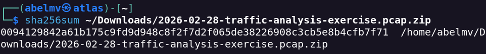
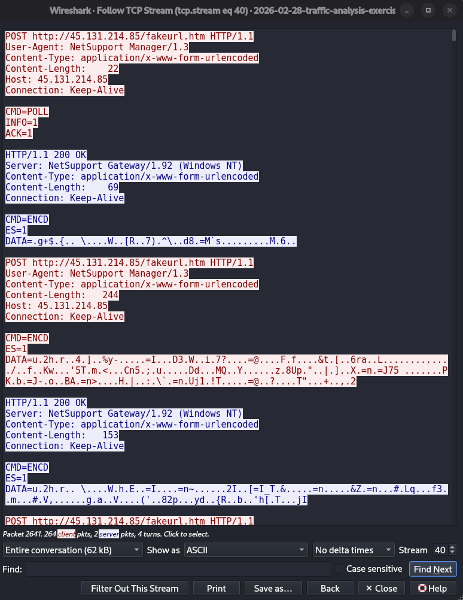
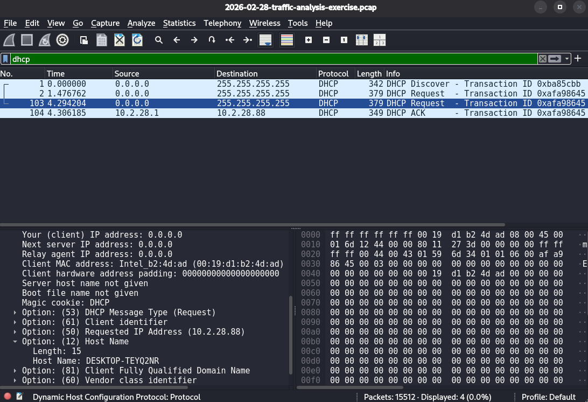
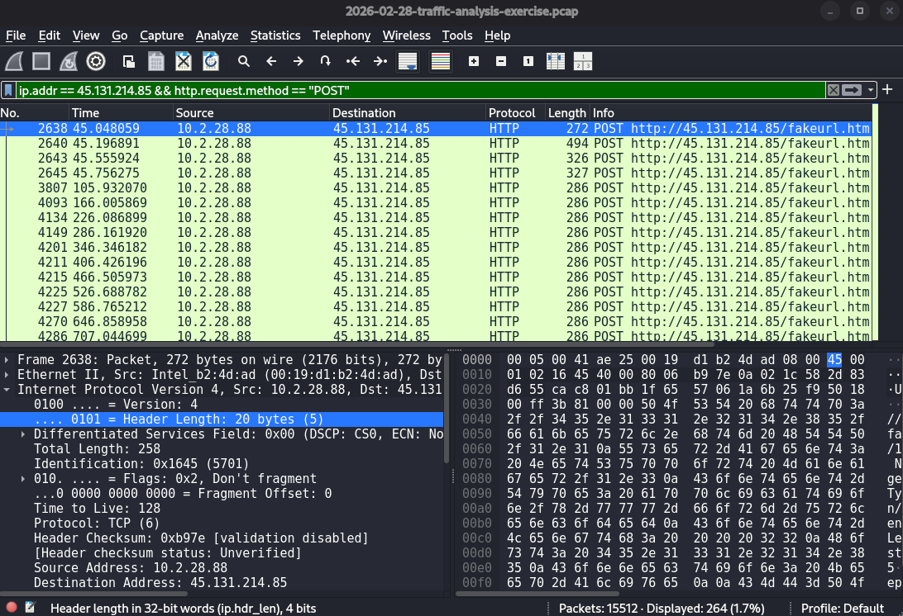

# Network Forensics Investigation — NetSupport RAT

## Overview

This project documents my investigation of a packet capture from the **Easy as 123** exercise published by [Malware-Traffic-Analysis.net](https://malware-traffic-analysis.net/2026/02/28/index.html). I used Wireshark and TShark to investigate suspicious HTTP traffic associated with NetSupport remote-control software, identify the internal host involved and examine the timing of its communications.

| Field | Details |
|---|---|
| Investigation date | 6 November 2026 |
| Traffic date | 28 February 2026 |
| Environment | Kali Linux |
| Tools | Wireshark, TShark, `sha256sum`, `awk` |
| Source evidence | `2026-02-28-traffic-analysis-exercise.pcap` (supplied as a ZIP archive) |
| Status | Completed with limitations |

The analysis used an existing training capture. I did not interact with the systems represented in the traffic. The original PCAP is **not redistributed** in this repository.

## Objective and Scope

My aim was to identify the Windows host associated with the reported suspicious traffic, inspect the relevant network communications and document findings supported by the capture. This is a **network-level investigation**, not a full examination of the affected endpoint.

## 1. Evidence Acquisition and Integrity

I downloaded the exercise ZIP and calculated its SHA-256 hash:

```bash
sha256sum ~/Downloads/2026-02-28-traffic-analysis-exercise.pcap.zip
```

```text
0094129842a61b175c6fd9d948c8f2f7d2f065de38226908c3cb5e8b4cfb7f71
```

I then compared the downloaded archive with a working copy:

```bash
sha256sum \
  ~/Downloads/2026-02-28-traffic-analysis-exercise.pcap.zip \
  ~/Digital-Forensics/Lab-01-Network-Forensics/2026-02-28-traffic-analysis-exercise.pcap.zip
```

Both calculated hashes matched, indicating that the two copies had identical contents. **Limitation:** I did not have a trusted publisher-provided hash against which to authenticate the original download.



*E01 — Hash calculation during evidence preparation.*

## 2. Initial Traffic Examination

I opened the capture in Wireshark:

```bash
wireshark ~/Digital-Forensics/Lab-01-Network-Forensics/2026-02-28-traffic-analysis-exercise.pcap
```

I reviewed **Statistics → Conversations → IPv4** to identify relevant endpoints. The exercise highlighted suspicious traffic involving `45.131.214.85` on TCP port `443`.

**Wireshark display filter:**

```text
ip.addr == 45.131.214.85
```

| Role | Address / Port |
|---|---|
| Internal host | `10.2.28.88` |
| External server | `45.131.214.85` |
| Destination port | TCP `443` |

## 3. NetSupport-Related HTTP Traffic

In frame **2638**, I observed an HTTP POST request from `10.2.28.88` to `45.131.214.85`.

| Field | Observed value |
|---|---|
| Method | `POST` |
| URL path | `/fakeurl.htm` |
| User-Agent | `NetSupport Manager/1.3` |
| Content-Type | `application/x-www-form-urlencoded` |
| Source | `10.2.28.88` |
| Destination | `45.131.214.85` |

Using **Follow → TCP Stream**, I examined stream `40` and recorded these relevant details:

```text
POST http://45.131.214.85/fakeurl.htm HTTP/1.1
User-Agent: NetSupport Manager/1.3

CMD=POLL
INFO=1
ACK=1

HTTP/1.1 200 OK
Server: NetSupport Gateway/1.92

CMD=ENCD
```

The `POLL` and `ENCD` messages, alongside the NetSupport headers, are consistent with remote-control communications. I did **not** decode the `ENCD` data or establish what specific instructions, if any, were executed.

Although the destination port was `443`, the observed application traffic was **HTTP rather than encrypted HTTPS**. Port numbers alone do not establish whether encryption is in use.



*E02 — HTTP request and response details visible in the reconstructed TCP stream.*

## 4. Identifying the Internal Host

### DHCP

I filtered DHCP packets:

```text
dhcp
```

Frame **103** contained a DHCP Request with the following details:

| Field | Observed value |
|---|---|
| IPv4 address | `10.2.28.88` |
| MAC address | `00:19:d1:b2:4d:ad` |
| Hostname | `DESKTOP-TEYQ2NR` |
| DHCP server | `10.2.28.1` |
| Transaction ID | `0xafa98645` |

Frame **104** was a DHCP ACK with the same transaction ID, supporting the link between the request and the server response.



*E03 — DHCP information identifying the Windows host in the training capture.*

### Kerberos

I also inspected authentication-related traffic:

```text
kerberos
```

Frame **243** contained a Kerberos AS-REQ associated with the same source IP:

```text
Client: brolf
Realm: EASYAS123
Source IP: 10.2.28.88
```

This identified the account `EASYAS123\brolf` in an authentication request. I examined additional LDAP and NTLMSSP traffic but could not verify the account holder's full name.

## 5. Periodic HTTP Communication

To focus on outbound POST requests to the identified server, I used:

```text
ip.addr == 45.131.214.85 && http.request.method == "POST"
```

I then extracted frame numbers and relative timestamps with TShark:

```bash
tshark -r ~/Digital-Forensics/Lab-01-Network-Forensics/2026-02-28-traffic-analysis-exercise.pcap \
  -Y 'ip.dst == 45.131.214.85 && http.request.method == "POST"' \
  -T fields -e frame.number -e frame.time_relative
```

To calculate intervals between selected requests, I used `awk`:

```bash
tshark -r ~/Digital-Forensics/Lab-01-Network-Forensics/2026-02-28-traffic-analysis-exercise.pcap \
  -Y 'ip.dst == 45.131.214.85 && http.request.method == "POST"' \
  -T fields -e frame.time_relative | \
  awk 'NR>=6 && NR<=12 {if (prev>0) printf "%.3f seconds\n", $1-prev; prev=$1}'
```

**Recorded intervals:**

```text
60.081 seconds
60.075 seconds
60.184 seconds
60.080 seconds
60.080 seconds
60.183 seconds
```

This approximately 60-second pattern is consistent with **periodic beaconing**. Regular timing alone does not prove malicious activity; its significance here comes from its correlation with the NetSupport-related traffic.



*E04 — Repeated POST activity. The interval measurements above were calculated separately with TShark and `awk`.*

## 6. TCP Connection Review

I inspected TCP SYN traffic involving the external server with this filter:

```text
ip.addr == 45.131.214.85 && tcp.flags.syn == 1
```

I also reviewed the recorded frames surrounding the HTTP request:

| Frame | Recorded observation |
|---|---|
| `2569` | SYN packet observed |
| `2636` | SYN-ACK packet observed |
| `2637` | ACK packet observed |
| `2638` | HTTP POST request observed |

**Interpretation limit:** The original notes list these frame numbers, but they do not provide enough connection identifiers to confirm that frame `2569` belongs to the same three-way handshake as frames `2636–2637`. I therefore do not present all three as one verified handshake without rechecking the source/destination ports and TCP stream identifiers.

I also applied:

```text
tcp.stream == 40 && (tcp.flags.fin == 1 || tcp.flags.reset == 1)
```

No FIN or RST packets were observed in stream `40` within the capture. This does **not** demonstrate that the connection remained open beyond the capture period.

## 7. Incident Timeline

I extracted the source and destination addresses and packet timestamps with TShark:

```bash
tshark -r ~/Digital-Forensics/Lab-01-Network-Forensics/2026-02-28-traffic-analysis-exercise.pcap \
  -Y 'ip.dst == 45.131.214.85 && http.request.method == "POST"' \
  -T fields -e frame.number -e frame.time -e ip.src -e ip.dst | head -n 10
```

**Selected events — 28 February 2026 (UTC), from the investigation notes:**

| Time (UTC) | Observed event |
|---|---|
| 19:55:51 | TCP connection activity |
| 19:55:51.530 | First observed HTTP POST |
| 19:55:52 | Additional POST requests |
| 19:56:52.415 | Periodic POST |
| 19:57:52.489 | Periodic POST |
| 19:58:52.570 | Periodic POST |
| 19:59:52.645 | Periodic POST |
| 20:00:52.829 | Periodic POST |

This timeline describes events **visible in the PCAP**, not the initial time of any suspected compromise.

## 8. Findings and Indicators

The principal finding was repeated communication from `10.2.28.88` to `45.131.214.85`, using NetSupport-related headers and messages. The traffic pattern was consistent with the exercise's remote-access alert, but network evidence alone did not establish a complete intrusion sequence.

| Indicator | Observed value |
|---|---|
| Internal host IP | `10.2.28.88` |
| External server IP | `45.131.214.85` |
| Destination port | TCP `443` |
| HTTP resource | `/fakeurl.htm` |
| User-Agent | `NetSupport Manager/1.3` |
| Server header | `NetSupport Gateway/1.92` |
| Message markers | `CMD=POLL`, `CMD=ENCD` |
| Recurring interval | Approximately 60 seconds |

These are **indicators observed in a historical training dataset**, not a statement that an address is currently malicious.

### Potential security impact

- Possible unauthorised remote access or command-and-control communication.
- Possible further activity on the Windows endpoint that is not visible in network traffic alone.
- A need for endpoint evidence to establish persistence, process activity and the true scope of the incident.

## 9. Recommendations

If similar activity were identified in a live environment, I would recommend:

1. Following the organisation's incident response process to assess whether the host should be isolated.
2. Preserving endpoint logs, volatile evidence and other relevant artefacts.
3. Checking installed software, processes and persistence mechanisms linked to NetSupport.
4. Correlating the observed communications with DNS, EDR, authentication and proxy logs.
5. Looking for related activity on other hosts before deciding on wider containment.

## 10. Limitations and Lessons Learned

**Limitations:**

- The original archive was not authenticated against a trusted external hash.
- The full name of the associated user was not verified.
- The `ENCD` message contents were not decoded, and no specific remote commands were confirmed.
- The endpoint itself was not examined.
- The listed TCP handshake frames require connection-level verification before being treated as one confirmed handshake.

**Lessons learned:**

- Using SHA-256 to compare evidence copies.
- Combining Wireshark and TShark for detailed traffic analysis.
- Using DHCP and Kerberos to connect network activity to a host and account.
- Identifying periodic communications using timestamp extraction and `awk`.
- Separating confirmed observations from plausible interpretations.

## Conclusion

This exercise helped me investigate suspicious network behaviour in a structured and reproducible way. I identified the internal host and associated authentication details, reconstructed NetSupport-related HTTP traffic and measured an approximately 60-second communication pattern.

The observations support the scenario's suspicion of remote-control activity, but they do not establish the complete extent of compromise. Further endpoint analysis would be needed to reach that conclusion.

## References

- [Malware Traffic Analysis — Easy as 123 (28 February 2026)](https://malware-traffic-analysis.net/2026/02/28/index.html)
- [Wireshark documentation](https://www.wireshark.org/docs/)
- [TShark manual](https://www.wireshark.org/docs/man-pages/tshark.html)
- [RFC 2131 — DHCP](https://www.rfc-editor.org/rfc/rfc2131)
- [RFC 4120 — Kerberos](https://www.rfc-editor.org/rfc/rfc4120)

---

*Part of the [Cybersecurity Portfolio](https://github.com/Abel-MV).*
